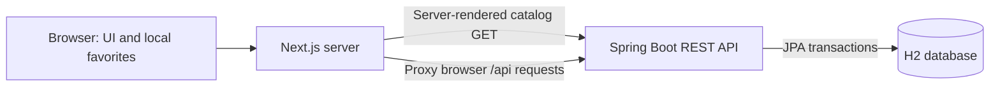

# DamTap

## 1. Project Overview

DamTap is a food-surplus marketplace for Astana, Kazakhstan. It connects people
looking for discounted meals and groceries with cafés, bakeries and shops that
have surplus products available for pickup.

The repository contains a Next.js frontend and a Spring Boot REST backend.
The current implementation supports a database-backed catalog, reservations and
partner applications. The interface is in Russian and prices are in Kazakhstani
tenge (KZT). Local seed records are illustrative; they do not establish commercial
availability at real venues. A public deployment is not verified.

## 2. Problem Statement

Food businesses may have unsold products while customers seek affordable food.
Without a shared channel for time-limited surplus offers, these needs are difficult
to match. Customers also need clear prices, remaining quantities, allergens and
pickup windows before making a reservation.

## 3. Proposed Solution

DamTap presents discounted offers in one searchable catalog. Customers can inspect
pickup details, save favorites and reserve available portions. Businesses can
submit contact details for potential onboarding. The backend stores offers,
reservations and partner applications and controls stock changes transactionally.

## 4. Key Features

- Responsive homepage with a Russian interface, category navigation and mobile
  bottom navigation.
- Catalog search across dish names, venues, districts and addresses; category
  filtering; sorting by distance, price, expiry or discount; filter reset.
- Offer details with KZT prices, calculated discounts, allergens, remaining stock,
  pickup instructions and dates displayed in the Astana time zone.
- Countdown timers calculated from the server-provided expiry timestamp.
- Favorites stored in the current browser's `localStorage`, with an in-memory
  fallback when browser storage is unavailable.
- Reservation submission with server-calculated totals and a confirmation ID.
  Database row locking protects the last available portion against simultaneous
  reservations; insufficient stock and expired offers return conflicts.
- Partner application submission persisted by the backend. Public receipts omit
  contact details; listing applications requires an administrator key.
- Administrator API for creating offers. Administrator endpoints are disabled
  unless a server-side key is configured.
- Catalog error state when the backend cannot be reached; no silent fallback to
  invented available stock.

## 5. Technology Stack

| Layer | Implementation |
| --- | --- |
| Frontend | Next.js 16.4.2 App Router, React 19.3, TypeScript |
| Styling and assets | Tailwind CSS v4, CSS tokens, Manrope via `next/font/google`, Lucide icons, WebP/PNG branding and illustrations |
| Backend | Java 17, Spring Boot 3.5.7, Spring Web, Jakarta Validation |
| Persistence | Spring Data JPA / Hibernate and H2; file-backed locally, in-memory in backend tests |
| Backend build | Maven Wrapper, Maven 3.9.9 |
| Checks | ESLint, Next.js production build, JUnit 5, Spring Boot Test, MockMvc |
| CI | GitHub Actions; the existing workflow runs frontend installation, lint and build |

PostgreSQL is not the currently implemented database: its driver, deployment and
migration configuration are not provided in this repository.

## 6. System Architecture



`app/page.tsx` loads `/api/offers` from the backend on each page request using
`cache: "no-store"`. The frontend then filters and sorts the loaded catalog locally.
Browser reservation and partner submissions use same-origin `/api/*` requests;
Next.js rewrites forward them to Spring Boot. Successful reservations update the
current page's remaining quantities. There is no cross-client real-time stock feed.

The backend validates requests, queries available offers and persists mutations.
`Offer`, `Reservation` and `PartnerApplication` are JPA entities. The database,
not a submitted client price, determines reservation totals.

## 7. Project Structure

```text
DamTap/
├── .github/workflows/ci.yml    # Frontend GitHub Actions checks
├── app/                       # Homepage, layout, styles, manifest and app icons
├── components/                # Header, hero, catalog, dialogs and other UI sections
├── data/offers.ts              # Offer types, client sorting and retained sample helpers
├── lib/api.ts                 # Browser API helper and response types
├── public/brand/              # Supplied Fork in D logo assets
├── public/images/             # Hero, food photos and section illustrations
├── backend/
│   ├── .mvn/wrapper/           # Maven Wrapper configuration
│   ├── mvnw, mvnw.cmd          # Unix and Windows Maven Wrapper launchers
│   ├── pom.xml
│   └── src/
│       ├── main/java/kz/damtap/backend/
│       ├── main/resources/    # Application properties and seed offers
│       └── test/java/kz/damtap/backend/
├── next.config.ts             # Backend proxy rewrites
├── package.json
└── package-lock.json
```

Only `/` is implemented as a marketplace page; offer details are dialogs, not
separate `/offers/[id]` routes. Local design packs, IDE settings, databases and
build output are excluded from version control. Required assets remain in `public/`.

## 8. Prerequisites

- Git.
- Node.js 24 and npm; Node.js 24 is used by the configured CI workflow.
- JDK 17 with `JAVA_HOME` pointing to that installation.
- Internet access for initial npm/Maven downloads and Google Fonts during an
  uncached frontend build. Maven does not need to be installed separately.
- Available local ports 3000 and 8080, or explicitly configured alternatives.

## 9. Installation and Local Setup

```bash
git clone https://github.com/commedeschamps/DamTap.git
cd DamTap
npm ci
```

Prepare a frontend-only environment file if using a non-default backend address:

```dotenv
# .env.local in the repository root; never commit real credentials.
BACKEND_URL=http://127.0.0.1:8080
```

Backend configuration uses process environment variables or Spring configuration;
Spring Boot does not automatically load the frontend's `.env.local` file.
No manual database installation or schema import is required for the default H2
configuration. Hibernate updates the schema at startup.

When the offers table is empty and seeding is enabled, the backend inserts eight
sample offers with pickup and expiry times relative to startup. It does not
replenish stock or extend expiry times on subsequent restarts. An empty catalog
may therefore mean that persisted offers have expired or sold out. For an isolated
fresh dataset, use a new H2 file through `DB_URL` rather than deleting an existing
database.

## 10. Environment Variables

| Variable | Consumer | Default | Purpose |
| --- | --- | --- | --- |
| `BACKEND_URL` | Next.js server | `http://127.0.0.1:8080` | Backend origin for server-side catalog loading and `/api/*` rewrites; do not add `/api` to this value |
| `SERVER_ADDRESS` | Spring Boot | `127.0.0.1` | Backend listening interface |
| `PORT` | Spring Boot | `8080` | Backend HTTP port |
| `DB_URL` | Spring Boot | `jdbc:h2:file:./data/damtap;DB_CLOSE_ON_EXIT=FALSE;LOCK_TIMEOUT=10000` | H2 connection URL; relative to the backend process's working directory |
| `DB_USER` | Spring Boot | `sa` | Local database username |
| `DB_PASSWORD` | Spring Boot | Empty | Local database password |
| `SEED_DEMO` | Spring Boot | `true` | Populate an empty offers table with sample records |
| `ADMIN_API_KEY` | Spring Boot | Empty | Enable administrator endpoints; supplied as the `X-Admin-Key` request header |

The empty database password is a local-development default, not a production
configuration. Keep real credentials outside Git and never expose `ADMIN_API_KEY`
as a `NEXT_PUBLIC_*` variable. With no administrator key, admin endpoints return
503. A missing or incorrect request key returns 401 when admin access is enabled.

Set `BACKEND_URL` before `npm run build` as well as when starting the server:
Next.js generates proxy rewrites during the build. If ports change, keep the proxy
and server-side catalog address consistent. Use Next.js's explicit `--port` option
for the frontend to avoid confusing it with the backend's `PORT` variable.

## 11. Running Frontend and Backend

Start the backend in terminal 1:

```bash
cd backend
./mvnw spring-boot:run
```

On Windows, use `mvnw.cmd spring-boot:run`. Running from `backend/` stores the
default local database under `backend/data/`. A database under the repository-root
`data/` directory belongs to a process started with that different working directory;
it is not a required application resource.

Start the frontend from the repository root in terminal 2:

```bash
npm run dev
```

Open `http://localhost:3000`. Check the API directly at:

```bash
curl http://127.0.0.1:8080/api/health
```

For a local frontend production build:

```bash
npm run build
npm start
```

The backend must also be running for catalog data, reservations and partner
submissions. A successful frontend build alone does not verify a working API or
a deployed service.

## 12. API Overview

All endpoints below are implemented in `ApiController`. Request and response
bodies are JSON; dates use ISO 8601 timestamps and prices are integer KZT amounts.

| Method | Endpoint | Behavior | Access |
| --- | --- | --- | --- |
| GET | `/api/health` | Return `{"status":"UP"}`; a basic application endpoint, not a complete readiness check | Public |
| GET | `/api/offers` | List non-expired offers with remaining stock; accepts `q`, `category`, `sort` | Public |
| GET | `/api/offers/{id}` | Read an individual offer | Public |
| POST | `/api/reservations` | Reserve 1–10 portions, decrement stock and return a receipt with a `Location` header | Public |
| GET | `/api/reservations/{id}` | Retrieve a reservation by UUID | Public; no account ownership check |
| POST | `/api/partner-applications` | Save a venue name and contact email; return an ID and timestamp | Public |
| POST | `/api/admin/offers` | Create a validated offer | `X-Admin-Key` |
| GET | `/api/admin/partner-applications` | List stored partner contacts | `X-Admin-Key` |

Catalog categories: `all`, `ready`, `bakery`, `fruits`, `dairy`, `meat`,
`groceries`, `drinks`. Sort modes: `recommended`, `distance`, `price`, `ending`,
`discount`. Search covers titles, venues, districts and addresses.

Example reservation for an available offer:

```bash
curl -X POST http://127.0.0.1:8080/api/reservations \
  -H 'Content-Type: application/json' \
  -d '{"offerId":"1","quantity":1}'
```

The server selects the price; clients must not submit a price field. A partner
application body has the shape `{"venue":"Example Bakery","email":"owner@example.com"}`.
Validation rejects unknown JSON fields and invalid quantities, prices or dates.
Client errors use Spring `ProblemDetail`, with field errors where applicable:
400 for invalid input, 404 for missing records and 409 for reservation conflicts.
No payment, login, cancellation, reservation-expiry release or partner-management
UI endpoint is implemented.

## 13. Testing and CI

Frontend checks from the repository root:

```bash
npm ci
npm run lint
npm run build
```

Backend checks with JDK 17:

```bash
cd backend
./mvnw test
```

The backend currently contains nine tests across `ApiIntegrationTest` and
`AdminDisabledTest`. They use in-memory H2 and cover catalog filtering, stock and
expiry rules, reservation totals, concurrent access to the last portion, validation,
partner persistence and administrator access. They do not require or overwrite a
local file-backed database.

`.github/workflows/ci.yml` runs `npm ci`, `npm run lint` and `npm run build` on
pushes and pull requests targeting `main`, and supports manual dispatch. Backend
tests are currently manual: the workflow does not run Maven. No frontend unit-test
or browser-test script is committed in `package.json`. The workflow's presence
does not establish the result of a particular GitHub Actions run.

## 14. Current Implementation Status

| Area | Current state |
| --- | --- |
| Homepage and branding | Implemented: Manrope, supplied Fork in D logo and detailed Astana hero |
| Catalog | Loaded from Spring Boot / H2; frontend filtering and sorting implemented |
| Favorites | Browser-local persistence; no cross-device synchronization |
| Reservations | API and UI implemented, persisted stock decrement and confirmation receipt |
| Pickup details | Address, time window, instructions and allergens displayed; seed information is illustrative |
| Partner applications | Form and persistence implemented; administrator-key-protected listing API |
| Database | H2 file storage locally; H2 in memory for tests; no PostgreSQL integration |
| Authentication and payments | Not implemented |
| CI | Frontend installation, lint and build configured; backend CI not configured |
| Deployment | No public deployment or production readiness verified |

`data/offers.ts` still contains sample generation helpers, but the homepage now
uses the backend catalog rather than those helpers as a fallback.

## 15. Limitations and Future Development

The service is intended to run locally with illustrative records at this stage.
Reservation lookup is not tied to an authenticated customer; public mutation
endpoints have no implemented rate limiting or identity controls. The administrator
key is a limited server-side access mechanism, not a full authentication system.
Do not treat the current API as ready for unrestricted production exposure.

Planned work includes customer and business authentication, reservation lifecycle
and cancellation policies, verified venue onboarding, administrative workflows,
payment integration, stronger abuse protection, database migrations and a tested
production database choice. PostgreSQL adoption, backend CI, committed frontend
interaction tests and deployment/monitoring require additional implementation.
Geolocation, distance calculation and live stock synchronization are not implemented;
distances are stored values. The catalog currently has no pagination.

## 16. Team Members and Responsibilities

DamTap is developed for the AITU diploma project. Responsibilities are:

| Team member | Responsibilities |
| --- | --- |
| Seidigali Rakhman Seidigaliuly | Frontend Development, UI/UX and Branding |
| Kenesbay Alizhan Nurzhanuly | Backend Development, Database and API |
| Shomanov Rakhat Alibekovich | QA, DevOps and Integration |

Git history records individual changes. This document describes the current
implementation and does not claim that planned features or deployment are complete.
